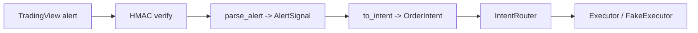

<p align="center">
  
</p>

<h1 align="center">TradingView Webhook Bot</h1>

<p align="center">
  <strong>Parse TradingView alert payloads into validated, broker-agnostic order intents — with HMAC auth.</strong><br>
  JSON or templated alerts in, signature-verified <code>OrderIntent</code> objects out, dispatched to a pluggable executor.
</p>

<p align="center">
  <em>Built and maintained by <a href="https://viprasol.com">Viprasol Tech</a> — Fintech Experts. Full-Stack Builders.</em>
</p>

<p align="center">
  <a href="https://github.com/Viprasol-Tech/tradingview-webhook-bot/actions/workflows/ci.yml"></a>
  <a href="LICENSE"></a>
  
  <a href="https://t.me/viprasol_help"></a>
  <a href="https://github.com/Viprasol-Tech/tradingview-webhook-bot/stargazers"></a>
</p>

---

> ## ⚠️ Disclaimer
> This software is for **educational purposes only** and is **not financial advice**. Automated trading involves substantial risk, including the **total loss of capital**. Always paper-trade with the in-memory executor first, secure your webhook endpoint, and comply with your broker's terms and your local laws. **Use at your own risk** — Viprasol Tech assumes no responsibility for your trading results.

---

## ✨ Features

- 🔁 **Two payload formats** — accepts both JSON alerts and TradingView's templated `{{ticker}}`/`{{strategy.order.action}}` `key=value` style.
- 🔐 **HMAC-SHA256 auth** — real, constant-time signature verification rejects forged or tampered payloads.
- 🧾 **Validated intents** — unknown actions and non-positive quantities are rejected before anything reaches a broker.
- 🔌 **Pluggable executor** — one `Executor` protocol; ship the included in-memory `FakeExecutor` or wire your broker SDK.
- 🧠 **Lenient field aliases** — `ticker`/`symbol`, `qty`/`contracts`, `buy`/`long`, and more map cleanly onto one model.
- 🖥️ **CLI** — `tradingview-webhook-bot demo` runs the whole parse → auth → intent → route pipeline offline.
- ⚙️ **Modern tooling** — ruff, mypy (strict), pytest, GitHub Actions CI.

## 🚀 Quickstart

```bash
git clone https://github.com/Viprasol-Tech/tradingview-webhook-bot.git
cd tradingview-webhook-bot
python -m pip install -e ".[dev]"

# Parse, authenticate and route two sample alerts — fully offline:
tradingview-webhook-bot demo
```

## 🧩 In-code usage

```python
from tradingview_webhook_bot import FakeExecutor, IntentRouter, sign_payload

payload = '{"ticker": "BTCUSDT", "action": "buy", "quantity": 0.5, "price": 64000}'
secret = "super-secret"

executor = FakeExecutor()
router = IntentRouter(executor, secret=secret)

order_id = router.handle(payload, sign_payload(payload, secret))
print(order_id)  # SIM-1
print(executor.received[0])  # OrderIntent(symbol='BTCUSDT', side=buy, ...)
```

## 🏗️ Architecture



## 🗺️ Roadmap

- [x] JSON + templated alert parsing into a typed `AlertSignal`
- [x] HMAC-SHA256 signing and constant-time verification
- [x] `OrderIntent` mapping with validation + pluggable executor
- [ ] Built-in HTTP receiver (stdlib) with replay protection
- [ ] Broker adapters (Alpaca, Binance, IBKR)
- [ ] Position sizing and risk filters

## 🤝 Contributing

PRs welcome — see [CONTRIBUTING.md](CONTRIBUTING.md) and our [Code of Conduct](CODE_OF_CONDUCT.md).

## Contact — Viprasol Tech Private Limited

- Website: [viprasol.com](https://viprasol.com)
- Email: [support@viprasol.com](mailto:support@viprasol.com)
- Telegram: [t.me/viprasol_help](https://t.me/viprasol_help) | WhatsApp: +91 96336 52112
- GitHub: [@Viprasol-Tech](https://github.com/Viprasol-Tech) | [LinkedIn](https://www.linkedin.com/in/viprasol/) | X [@viprasol](https://twitter.com/viprasol)

## License

[MIT](LICENSE) (c) 2025 Viprasol Tech Private Limited
